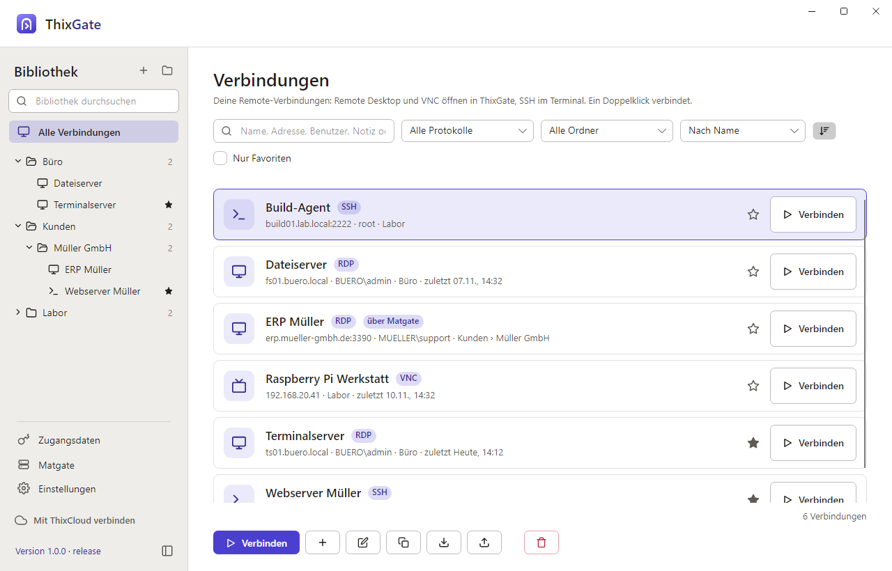
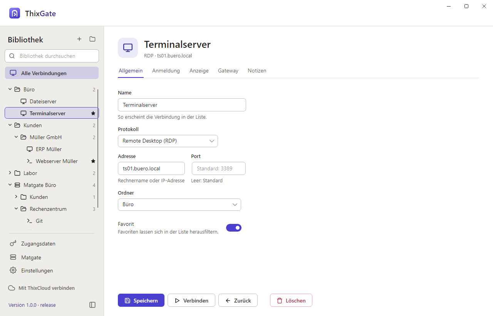
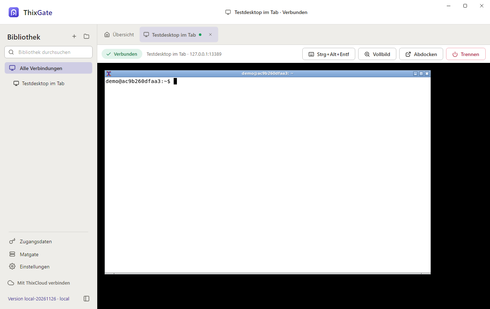
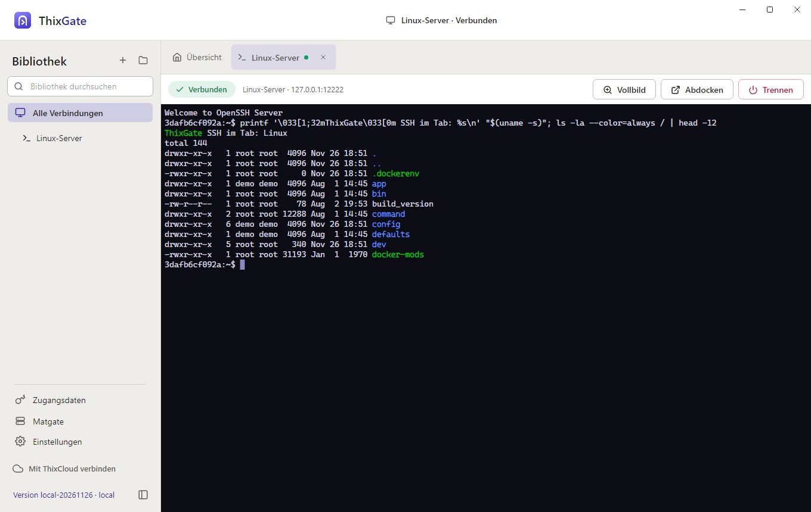
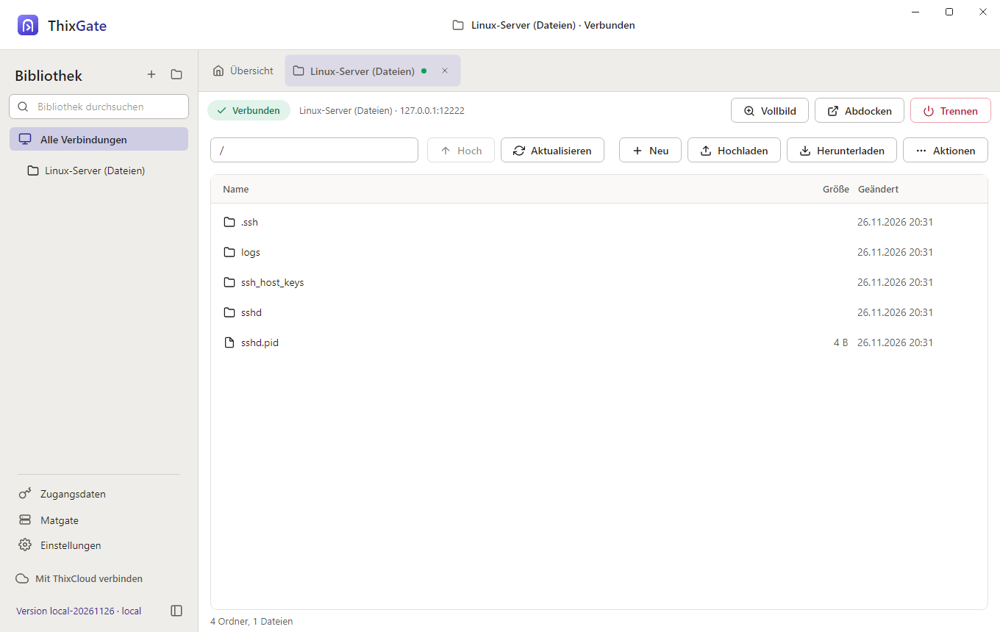
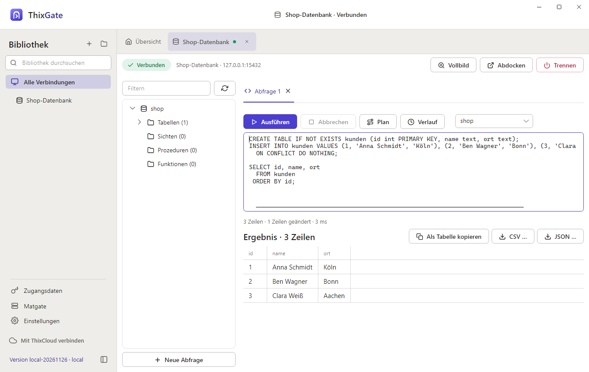
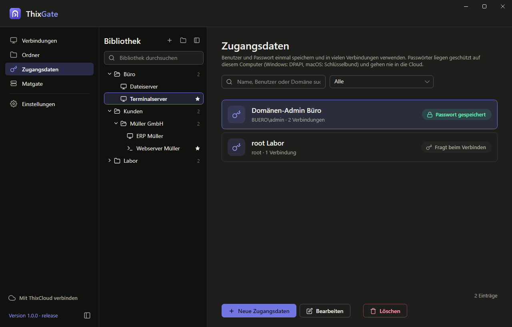
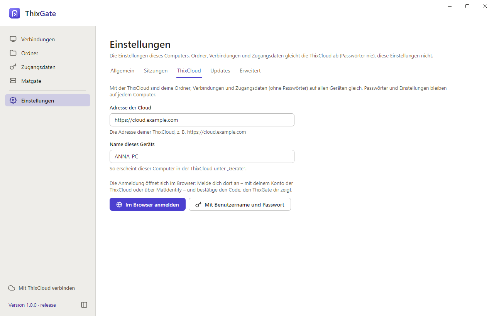
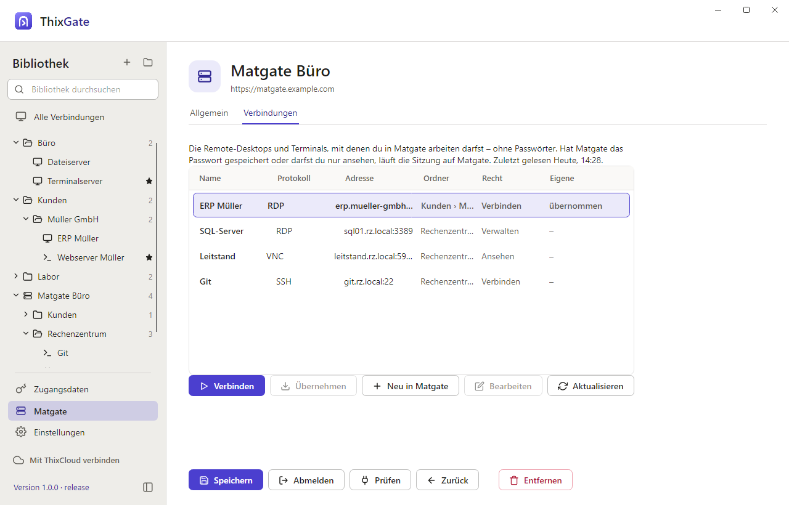
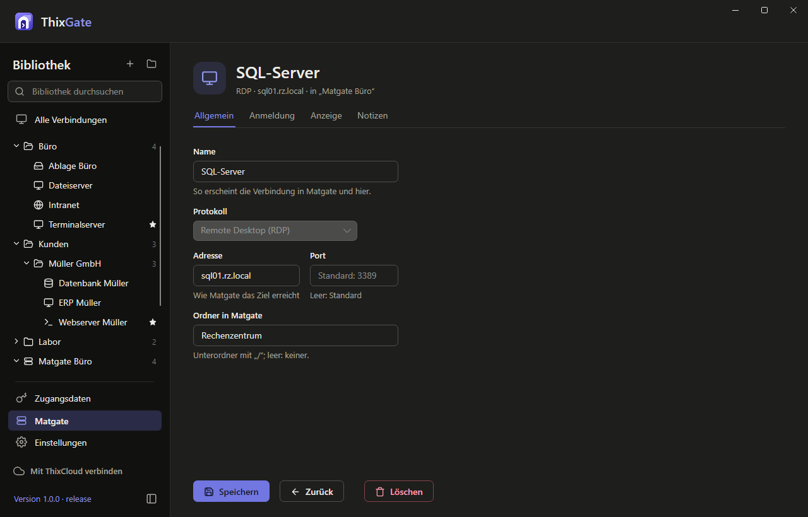

<p align="center"></p>

# ThixGate

**Remote-Verbindungen an einem Ort – für Windows und macOS.** Ordner, Verbindungen (Remote Desktop, VNC, SSH, Dateien über SFTP, FTP,
SMB und WebDAV, Websites, Datenbanken) und gespeicherte Zugangsdaten in einer Bibliothek. Alles öffnet als Tab im Hauptfenster: Remote
Desktop und VNC mit der Engine von [Matgate](https://github.com/Real-TTX/Matgate) (das Bild wird ohne Umweg gezeichnet), SSH im eigenen
Terminal, Dateien und Datenbanken mit Matgates Code, Websites im Browser des Systems.

ThixGate ist die **On-Premise-Alternative** zu Matgate und braucht es nicht. Wer mag, gleicht die Bibliothek über die **ThixCloud**
zwischen seinen Geräten ab (Passwörter nie) und meldet sich bei einem **Matgate** an: dessen Verbindungen erscheinen in ThixGate,
verbunden wird über Matgate.



## Funktionen

| | |
|---|---|
| **Bibliothek** | Ordner (auch ineinander), Verbindungen mit Protokoll, Adresse, Port, Benutzer, Notiz, Schlagwörtern und Favoriten. Das **Menü ist die Bibliothek als Baum**: Ordner auf- und zuklappen (ein Klick zeigt ihre Verbindungen), durchsuchen, Doppelklick verbindet, rechte Maustaste für alles Weitere; darunter Zugangsdaten, Matgate und Einstellungen. Dazu die Liste mit Suche, Filter (Protokoll, Ordner, Favoriten), Sortierung und Seiten. |
| **Remote Desktop & VNC** | Als **Tab rechts vom Menü** wie in Royal TS (abdocken in ein eigenes Fenster und wieder andocken, oder auf Wunsch immer im eigenen Fenster / Vollbild), mit Matgates Engine (`Mat.Remote`): Bild direkt gezeichnet, Maus, Rad, Tastatur (Scancodes für RDP, Keysyms für VNC), Auflösung folgt dem Fenster, Strg+Alt+Entf, Anmeldung mit NLA. Bildqualität wie in Matgate. **Zwischenablage in beide Richtungen** (Text, Bilder und Dateien – kopierte Dateien landen in Explorer / Finder). **Laufwerke:** Ordner oder alle Laufwerke dieses Computers erscheinen im Explorer des Remote-PCs. **Mehrere Monitore:** einer, alle oder ausgewählte – je Verbindung oder als Standard. **Status:** Latenz, Bilder/s und Datenrate in der Leiste, die letzte Minute als Graph. **Vollbild** mit einer Leiste am oberen Rand (anheften, minimieren, Vollbild beenden, trennen). Import aus .rdp-Dateien mit Monitoren und Laufwerken. |
| **SSH** | Im **eigenen Terminal als Tab** (xterm-256color: Farben, Vollbildprogramme wie vim, htop und mc, Maus, Rückblick mit dem Mausrad, Markieren und Kopieren, Einfügen mit Strg+Umschalt+V / Cmd+V), angemeldet mit Passwort, Schlüsseldatei (mit Passphrase) oder was der Server fragt. Den Schlüssel eines neuen Servers bestätigst du einmal, ein geänderter Schlüssel warnt. Auf Wunsch weiter im Terminal des Systems (Windows Terminal, Terminal.app, ein eigenes) – das Passwort steht dort nie auf einer Befehlszeile. |
| **Dateien** | **SFTP, FTP, SMB und WebDAV** als Dateimanager im Tab (Matgates Code): Ordner wechseln, Neu (Ordner, Datei), Hochladen (Dateien, ganze Ordner, ein Archiv entpackt; oder aus dem Explorer / Finder hineinziehen), Herunterladen (auch Ordner und als ZIP), Öffnen mit dem Programm des Computers, Umbenennen, Löschen, ZIP erstellen, Entpacken (zip, rar, 7z, tar, gz …), Kopieren / Ausschneiden / Einfügen auch zwischen zwei Datei-Tabs. Ein Startordner hält die Verbindung in ihrem Bereich. |
| **Datenbanken** | **SQL Server, MySQL / MariaDB und PostgreSQL** wie in Matgate: Objekt-Explorer (Tabellen, Sichten, Prozeduren, Funktionen; Spalten, Schlüssel, Indizes, Fremdschlüssel), Abfragen mit mehreren Ergebnissen (Strg+Enter / F5, nur die Auswahl), Abbrechen, Plan, Verlauf, Zeilen seitenweise und sortiert, **Zeilen bearbeiten** (mit Vorschau, in einer Transaktion), **Tabellen entwerfen**, CREATE-Skripte, Export als CSV oder JSON. |
| **Websites** | Im **Browser des Systems als Tab** (WebView2 / Edge unter Windows, WebKit unter macOS) mit Zurück, Vor, Neu laden und Adresszeile; Anmeldung wie in Matgate (HTTP Basic mit den Zugangsdaten, Proxmox VE / Backup Server automatisch), selbst ausgestellte Zertifikate auf Wunsch, Anmeldungen bleiben je Verbindung. |
| **Zugangsdaten** | Einmal speichern, in vielen Verbindungen verwenden. Passwörter geschützt auf dem Gerät (Windows DPAPI, macOS Schlüsselbund). |
| **ThixCloud** | Ordner, Verbindungen und Zugangsdaten (ohne Passwörter) auf allen Geräten gleich – Anmeldung im Browser oder mit Passwort. |
| **Matgate** | Optional: Matgate eintragen und **im Browser anmelden** (Passwort, zweiter Faktor, Single Sign-on wie gewohnt, dann „ThixGate zulassen“). Seine Remote-Desktops, Terminals, Dateien, Websites und Datenbanken, mit denen du dort arbeiten darfst (ohne Passwörter), stehen **direkt im Baum** – mit Matgates Ordnern, ohne sie zu übernehmen: Doppelklick verbindet, rechte Maustaste bearbeitet sie in Matgate; übernehmen in die eigene Bibliothek geht auf Wunsch weiter. Verbunden wird **über Matgate** (auch durch seine Tunnel), mit ThixGates Engine und den Passwörtern von diesem Computer – oder als **Sitzung auf Matgate**, wenn nur Matgate das Passwort kennt oder du nur ansehen darfst: Matgate meldet sich an, das Bild kommt zu ThixGate. Mit den Rechten dazu legst du Verbindungen in Matgate an, änderst und löschst sie (nie mit Passwort). |
| **Import / Export** | `.rdp`-Dateien und die eigene Bibliothek (`*.thixgate.json`, ohne Passwörter). |
| **Desktop** | Infobereich / Menüleiste mit Favoriten und zuletzt verwendeten Verbindungen, Autostart, Hell/Dunkel, Updates über das Netz (auf Wunsch vollautomatisch), Setup ohne Administratorrechte (Windows), App-Bundle (macOS). |
| **Richtlinien** | `LockConfiguration`, `DisableCloud`, `DisableUpdates`, `DisableMatgate`, `DisableSavedPasswords` – Windows `HKLM\SOFTWARE\Policies\ThixGate`, macOS Profil `info.schmoldt.thixgate`. |

| | |
|---|---|
|  |  |
|  |  |
|  |  |
|  | |
|  |  |

## Installation

- **Windows:** `ThixGateSetup.exe` aus den [Releases](https://github.com/Real-TTX/ThixGate/releases) – installiert für dein Konto, ohne Administratorrechte.
- **macOS:** `ThixGate-macOS-arm64.dmg` (Apple Silicon) bzw. `-x64.dmg` (Intel) öffnen und ThixGate in „Programme“ ziehen.

Kanäle: `main` → Release (`0.1.<build>-<datum>`), `dev` → Nightly (`nightly-<build>-<datum>`); installierte Versionen aktualisieren sich selbst.

## Entwicklung

```
git clone --recurse-submodules https://github.com/Real-TTX/ThixGate.git
dotnet build ThixGate.slnx
dotnet test ThixGate.slnx
```

Aufbau, Regeln und Tests: [CLAUDE.md](CLAUDE.md). Logo: [branding/](branding/README.md).

© Matthias Schmoldt
